# Design proposal (Phase 3, 23 Nov 2026)

How the three surfaces should change, based on [UX_AUDIT.md](UX_AUDIT.md). **Nothing here is built yet.** The mockups below were made by injecting CSS and HTML into the real production build. They use the same data, fonts and widths, so the measurements are real, but the source code is unchanged. Phase 4 starts only after you approve.

## 1. The direction question (your decision)

The brief for this round suggests a new look: navy or evergreen, gold, festive red, softer corners, glass panels. CLAUDE.md and your earlier decisions say the opposite:
- near-black, electric ice blue `#3FD0FF` and white;
- Barlow Condensed italic, square corners and snowfall;
- softer, playful versions were turned down as «girly», «AI-looking» and «not professional»;
- no rounded cards, pastels, candy-cane red-and-white, light strings or gradient washes.

The mascot art, the overlay and the sponsor deck are all built on the ice look.

| | **A. Premium and calm, same identity** (recommended) | **B. Festive navy and gold** (only if you want a new identity) |
| --- | --- | --- |
| Look | Same colours, type and square corners. Fewer competing things per screen, a clearer hierarchy, one accent, more air. | Navy or evergreen background, gold accent, festive red, rounded glass panels. |
| Fits | Everything that exists: mascot art, overlay, sponsor deck, /mod. | Needs a new palette for the mascot glow, overlay, deck and /mod, and new sponsor screenshots. |
| Risk | Low; it's a refinement. | High. It's close to what was rejected before, and it means two looks would be live while it's changed, 4 weeks before the start. |

**Decided 23 Nov 2026: A.** The owner saw both side by side (below) and chose the same identity.

### A and B side by side

Both use the proposed hero layout from section 4 on the real build. B is a quick recolour, not a finished design: near-black becomes navy, ice blue becomes gold, boxes get 12–18 px corners and translucent glass, and the background gets navy and evergreen glows. The mascot art and the wheel emote are unchanged, so they stay ice blue in B. In a real B they would need new art.

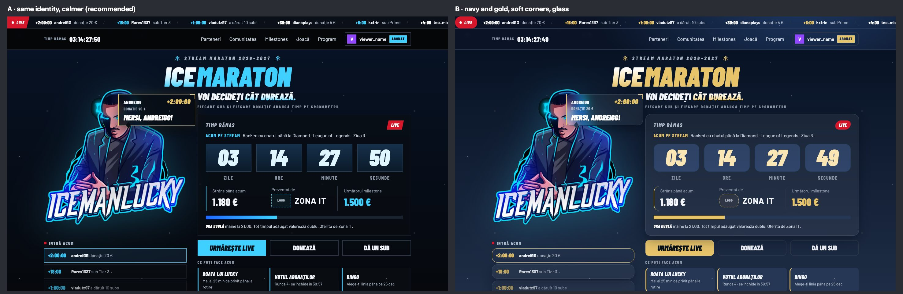

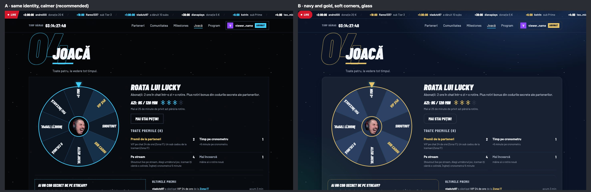

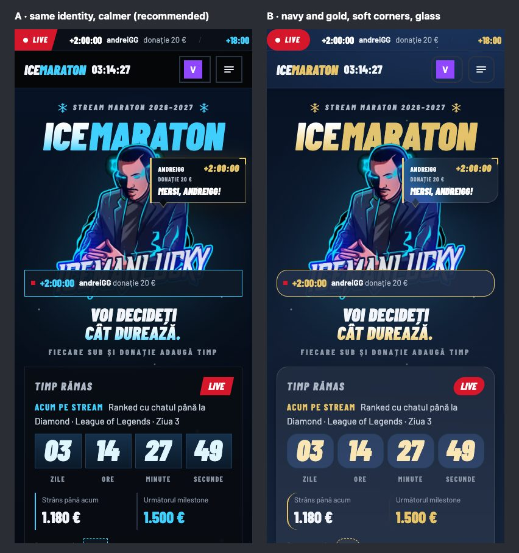

## 2. Principles for A

1. **One number per screen.** On the viewer page, the timer and the main sponsor's «Prezentat de» line are the first thing you see, on every screen size.
2. **One next step.** Each visitor sees what *they* can do now, in their state (logged out, not subscribed, subscribed).
3. **Nothing unfinished in public.** Empty sponsor boxes, `[PLACEHOLDERS]` and `#` links aren't shown. Either the real content is there, or a calm line takes its place.
4. **Honest.**
   - The calculator only promises time the server will add.
   - Scarcity only where it's true (a tier that's taken).
   - No countdown pressure on sponsors or viewers.
5. **Calm sponsors.** Logos on dark panels, no flashing, unchanged.
6. **Same motion language.** Reuse the «tăietura» motion tokens (`--m-fast`, `--m-base`, `--m-slow`, `--m-skew`), and every new movement gets a reduced-motion fallback.

## 3. Tokens: tidy-up, no new colours

The palette stays, but its use has spread: the source uses 73 different hex colours, many of them inline. Phase 4 would collect the ones in use into named CSS variables in `global.css` and use them in new and touched code:

| Token | Value | Contrast on `#090C11` | Use |
| --- | --- | --- | --- |
| `--text` | `#F2F5FA` | 17.9 : 1 | Body and headings |
| `--text-2` | `#C9D2DF` | 12.8 : 1 | Secondary body |
| `--text-3` | `#AEB8C7` | 9.8 : 1 | Labels |
| `--text-4` | `#8C97A8` | 6.6 : 1 | Hints, timestamps (lowest for text) |
| `--line` | `#1C2230` | (not text) | Panel borders |
| `--panel` | `#090C11` | (not text) | Cards |
| `--ice` | `#3FD0FF` | 10.9 : 1 | Accent, primary buttons |
| `--live` | `#D5162B` | (fills only) | LIVE tag, danger zone |

`#4A5568` (2.6 : 1) is used as a *text* colour in one place: the community-goal hours. That's logged as B-32 and moves to `--text-4`. It stays fine for icons and dots, which aren't text. The prism gradient for first place stays as approved in layout v2.

## 4. Viewer page

### Mockup 1: the hero (V1 + V2 + V5)

**Before.** At 1440 × 900 the first screen is the title, the mascot, the feed and the calculator. The countdown starts below the fold.

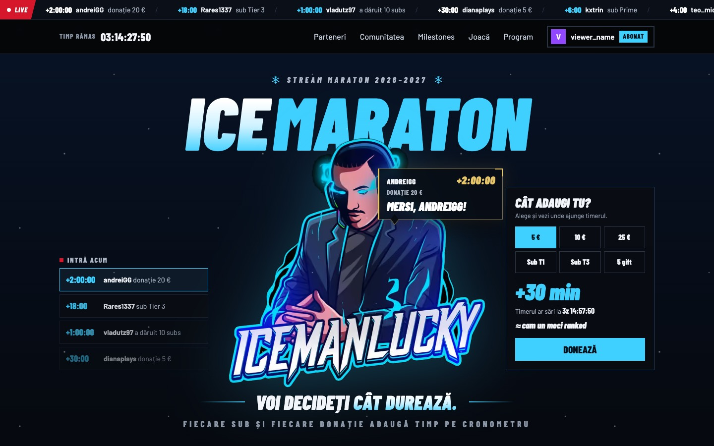

**After.** The mascot moves to the left and the timer card to the right, so the digits, «Strâns», «Prezentat de Zona IT» and «Următorul milestone» are all on the first screen. Below the card:
- three equal buttons: «Urmărește live», «Donează», «Dă un sub»;
- the «Ce poți face acum» row;
- «Cum adaugi timp».

The «Intră acum» feed sits under the mascot, and «Cât adaugi tu?» follows.

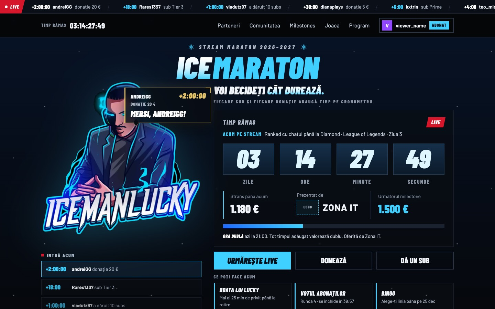

At 1280 × 720, the smallest common laptop:

| Before | After |
| --- | --- |
| 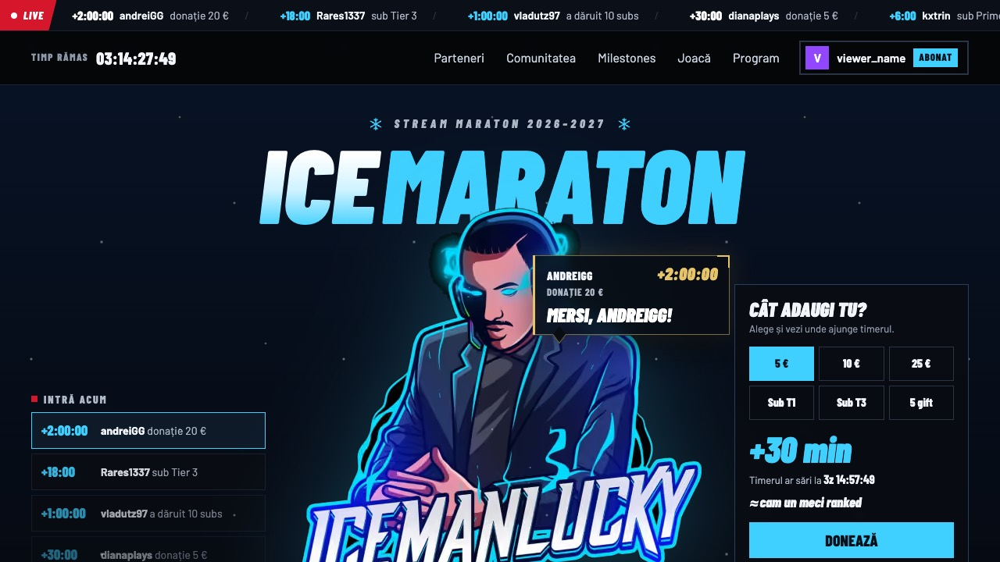 | 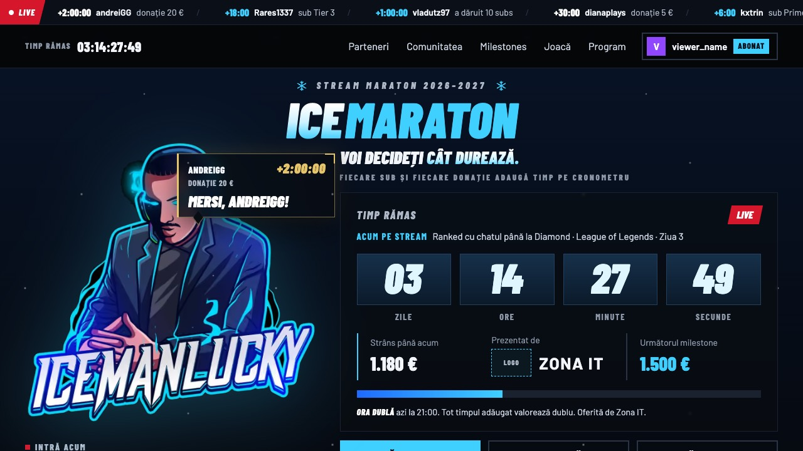 |

Measured on the real page:

| Screen | Digits end at (before → after) | «Prezentat de» ends at (before → after) | On the first screen after? |
| --- | --- | --- | --- |
| 1280 × 720 | 1,100 → **487 px** | 1,226 → **607 px** | Yes |
| 1440 × 900 | 1,133 → **509 px** | 1,267 → **637 px** | Yes |
| 1920 × 1080 | 1,134 → **523 px** | 1,268 → **651 px** | Yes |
| 390 × 844 | 721 → 721 px | 864 → 864 px | Phone layout unchanged |

**What stays.**
- The title with the white-to-ice «ICE».
- Iceman's bubble on the mascot, the snowfall and the eyebrow line.
- «Voi decideți cât durează.», now at the top of the timer column.
- The rates and every element that's already there.
- The navbar is untouched, so it stays on one row.

**What the build needs.** Only the desktop grid in `v2.css` changes:
- `grid-template-areas: "mascot line" "mascot timer" "ev cta" "ev calc"`;
- the title drops from 150 px to about 92 px;
- the rate chips move out of the card, under the buttons.

Phones keep today's order and gain the «Ce poți face acum» row: on phones it becomes one row of three compact tiles rather than three stacked boxes. Above 2,400 px the page still scales with `zoom`, so 2K and 4K follow the 1920 layout; Phase 4 will check them.

**«Ce poți face acum»** is filled from what the page already knows. No new data is needed.

| Viewer | Tiles |
| --- | --- |
| Logged out | «Conectează-te cu Twitch»: one line on what it unlocks (vote, wheel, bingo, your contribution) · «Bingo · alege-ți linia» · «Votul · runda N» |
| Not subscribed | «Bingo» · «Cod secret · rotire bonus» · «Dă un sub ca să votezi» |
| Subscribed | «Roata · ai 1 rotire» or «mai ai 25 min» · «Votul · runda 4 · 39:57» · «Bingo · alege-ți linia până pe 25 dec» |
| Before the start or ended | Hidden |

Each tile is a real `<a>` to its section, at least 52 px tall, with the text in `--text`/`--text-3`. A tile shows only what is true right now: no invented urgency.

### Mockup 2: partners without empty boxes (V4)

**Before.** The main sponsor, then four «[Partener 1–4]» tiles with LOGO boxes, six empty supporter boxes, and «Scrie-ne la [EMAIL CONTACT]».

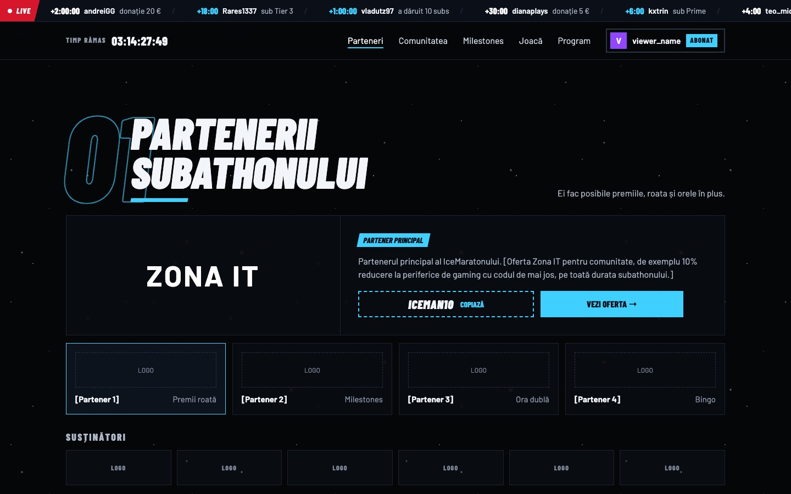

**After.** The main sponsor, then a single line: «Locuri libere pentru parteneri. Premii pe roată, milestone-uri, Ora dublă, bingo. · Vezi cum arată pentru brandul tău →», which links to `/sponsori`. Real partners appear as tiles as soon as they're added. The section is 246 px shorter.

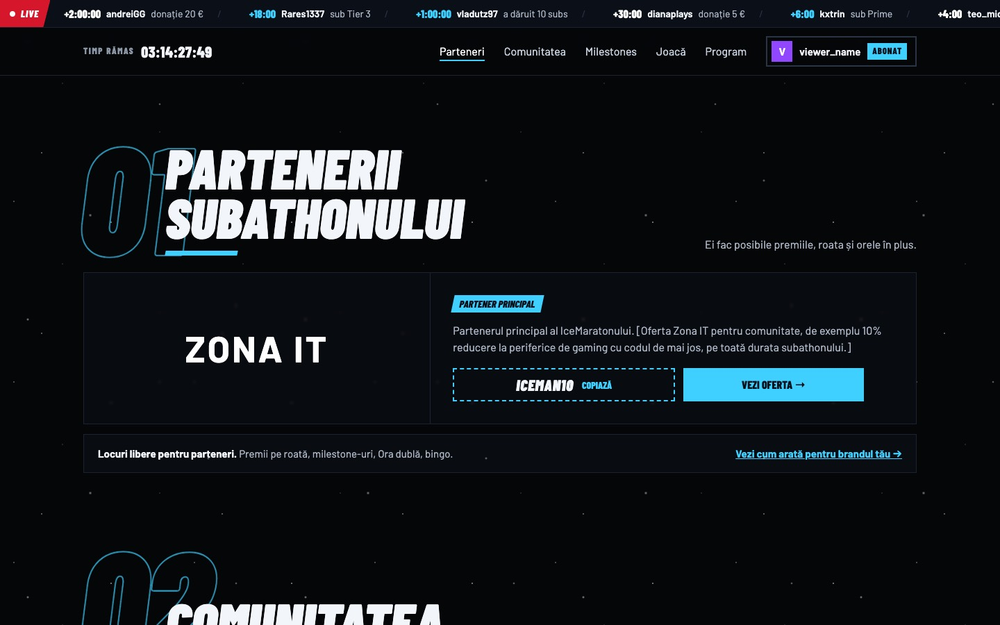

### Other viewer changes

- **V2 «Donează»:** link to the TipeeeStream page and split off «Dă un sub» (`twitch.tv/subs/icemanlucky`). This needs the donation URL from you.
- **V3 calculator before the start:**
  - Option (a), wording: the result reads «se adună la Strâns» and the timer line is hidden, until the timer is live.
  - Option (b), banked time: the server adds the time to the opening duration. This needs a database change.
- **Phones:** toasts that arrive in the first 3 s wait, so they don't cover the hero.

## 5. Moderator console

No mockup. These are behaviour changes in the existing /mod look.

- **M2 danger zone.** «Încheie subathonul» leaves the Cronometru card for a «Zonă periculoasă» panel at the end of the LIVE group: a thin `--live` border, one sentence on what happens, and a dialog in the site's style where you type «ÎNCHEIE». The time buttons stay where they are.
- **M3 unsaved edits.**
  - Any card with changes gets a small «NESALVAT» tag next to its title, in the same style as the «FĂCUT ✓» tags.
  - The save button sticks to the bottom of the screen while you edit a long card.
  - Leaving the page with unsaved changes asks first (`beforeunload`).
- **M4 status on phones.** One chip in the bar: «Totul merge», «1 problemă · Donații» (amber) or «Fără conexiune» (red). It opens «Conexiuni». Desktop keeps the four labelled dots.
- **M5 keyboard.**
  - Skip links «Sari la cronometru» and «Sari la De făcut acum».
  - The sidebar is one Tab stop, moved through with ↑/↓.
  - When the tab becomes visible again, /mod reloads its data and reconnects Realtime (this also fixes B-14).
- **M1 sponsors on /mod.**
  - A form in Sponsori → «Parteneri și logo-uri»: tier, name, logo, link, code, what they back, order, visible.
  - The same settings row holds the donate link and socials.
  - It needs a `sponsors` table and a `public_state` part, so it's a migration that needs your OK. Until then, sponsors stay in `src/data/site.ts`.

## 6. Sponsor deck (/sponsori)

- **S1 new step 10, «Hai să vorbim».**
  - Brand (already typed), package (Partener principal / Partener / Susținător / Altceva), name, email and a short message, with one button: «Trimite».
  - Two ways to send it:
    - **A:** email, with no backend.
    - **B:** an inbox on /mod, which needs a migration and a privacy line.
  - Either way there's no payment, and the deck says payment is by invoice. See UX_AUDIT.md, «Sponsor checkout».
- **S2 step 1 numbers:** your real numbers, with a source line («Sursa: Twitch Analytics, subathonul din …»). I won't fill them in without you.
- **S3 step 9 packages:** a comparison table with what each tier gets over 22 days, and a price or «la cerere» per tier. A tier that's taken shows «Ocupat».
- **S4 `?brand=` links:** `/sponsori/?brand=Zona%20IT` opens the deck already personalised. Step 1 gets one line pointing at the brand field.
- **S5 phones:** text first and the preview under it; step buttons 44 × 44 px (B-24).

## 7. Phase 4 plan (after your OK)

Surface by surface, in small commits. After each commit I re-run `npm test` and the Phase 1 browser checks (7 widths, navbar on one row, reduced motion, console errors, Lighthouse a11y).

1. **Viewer**
   - V4 empty partners
   - V1 hero layout
   - V5 «Ce poți face acum»
   - V3 calculator (option a, unless you pick b)
   - B-32 contrast
   - V2 once you send the donation URL
2. **/mod**
   - M2 danger zone
   - M3 unsaved changes
   - M4 status chip
   - M5 keyboard and reconnect
3. **/sponsori**
   - S4 `?brand=`
   - S5 phone layout
   - S1 «Hai să vorbim», as option A (email) unless you pick B
   - S2 and S3 once you send numbers and package details

Not in Phase 4 unless you say so:
- M1 (needs a migration);
- S1 option B (needs a migration);
- V3 option (b) (needs a database change);
- any identity change (option B in section 1).

## 8. What I need from you

1. **Direction:** A (same identity, calmer) or B (navy and gold).
2. **Calculator before the start:** (a) wording or (b) banked time.
3. **Sponsor inquiry:** A (email) or B (inbox on /mod), plus the contact email.
4. **Content, whenever you have it:** the TipeeeStream donation URL, the audience numbers and their source, the package details and prices, and confirmation that Zona IT is signed.

## 9. Phase 4: what was built (23 Nov 2026)

Direction A, built surface by surface in small commits. After each commit: `npm test` (10/10), `astro check` (0 errors) and browser checks. Nothing is pushed or deployed.

### Viewer page
- **V4 (reverted 23 Nov at the owner's request):** the owner prefers seeing every sponsor slot, so the section is back to the main partner, four partner tiles and six supporter boxes. What follows describes the version that was reverted. Only sponsors filled in `site.ts` are shown. Open partner slots become one «Locuri libere pentru parteneri» line that links to /sponsori. The `[EMAIL CONTACT]` mailto, the `#` «Vezi oferta» link and the `#` social links stay hidden until real values exist.
- **V1:** two-column hero on desktop. The rate chips sit under the buttons on desktop and right under the timer card on phones. The calculator puts its six options on one row on desktop.
- **V2 (part):** «Urmărește live» and «Dă un sub», which uses the real subscribe link. The «Donează» buttons appear once `site.links.donate` is set.
- **V5:** the «Ce poți face acum» row, per viewer state, shown only while the marathon is live.
- **V3, option (a) / B-31:** before the start, the calculator says time is added from the start date, and that until then donations count toward Strâns and the milestones.
- **B-32:** the hours of community goals not yet reached are now `#8C97A8`.

| Screen | Digits end at (before → after) | «Prezentat de» ends at (before → after) |
| --- | --- | --- |
| 1280 × 720 | 1,100 → **509 px** | 1,226 → **636 px** |
| 1440 × 900 | 1,133 → **533 px** | 1,267 → **667 px** |
| 1920 × 1080 | 1,134 → **547 px** | 1,268 → **681 px** |
| 390 × 844 | 721 → 721 px | 864 → 864 px |

| Before | After |
| --- | --- |
| 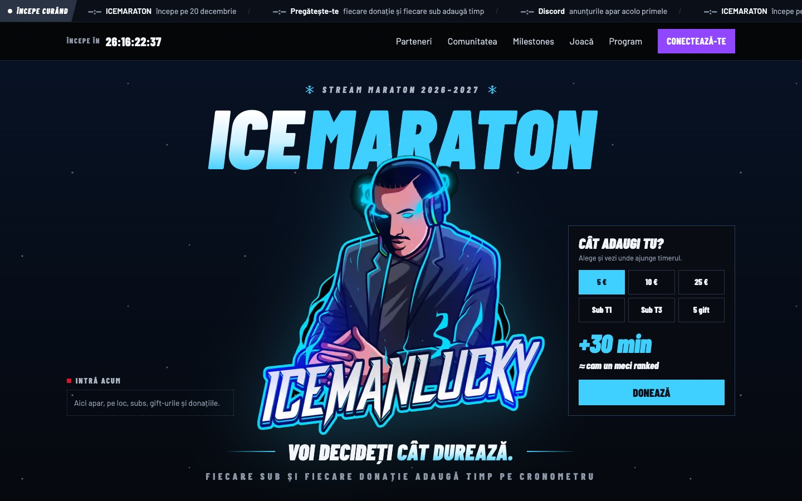 | 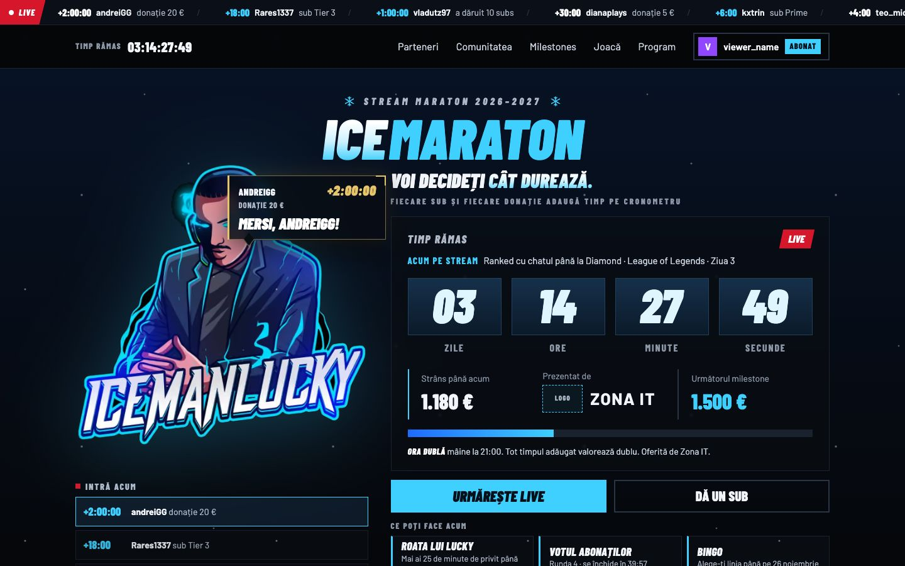 |
|  | 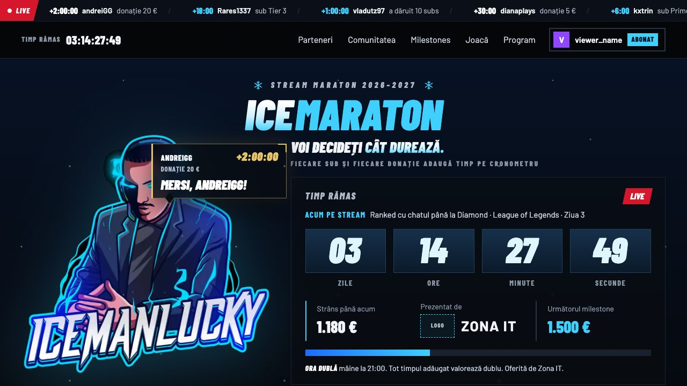 |
|  | 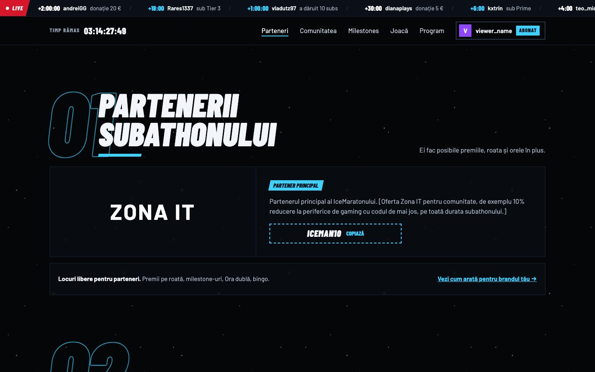 |

Phone, under the timer card: the rate chips, the calculator with the pre-start note, «Urmărește live» / «Dă un sub», then «Ce poți face acum» while live.

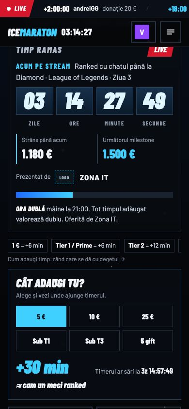

### /mod
- **M2:** «Încheie subathonul» now lives in a «Zonă periculoasă» card at the end of LIVE. It opens a dialog where you type ÎNCHEIE (diacritics optional).
- **M3:** cards with unsent edits get a «Nesalvat» tag, their save row sticks to the bottom, and leaving the page asks first.
- **M4:** phones show one chip: «Totul merge», «N probleme · …» or «Fără conexiune».
- **M5:** skip links, a one-Tab-stop menu moved with the arrow keys, and focus moves to the section you open.
- **B-14:** /mod reloads when Realtime (re)joins, the tab is visible again, or the network returns.

| Before (phone) | After (phone) | After (danger zone) |
| --- | --- | --- |
| 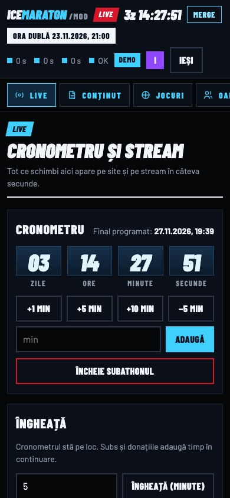 | 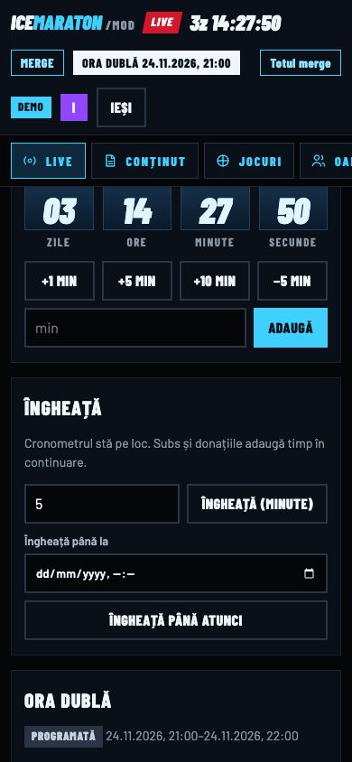 | 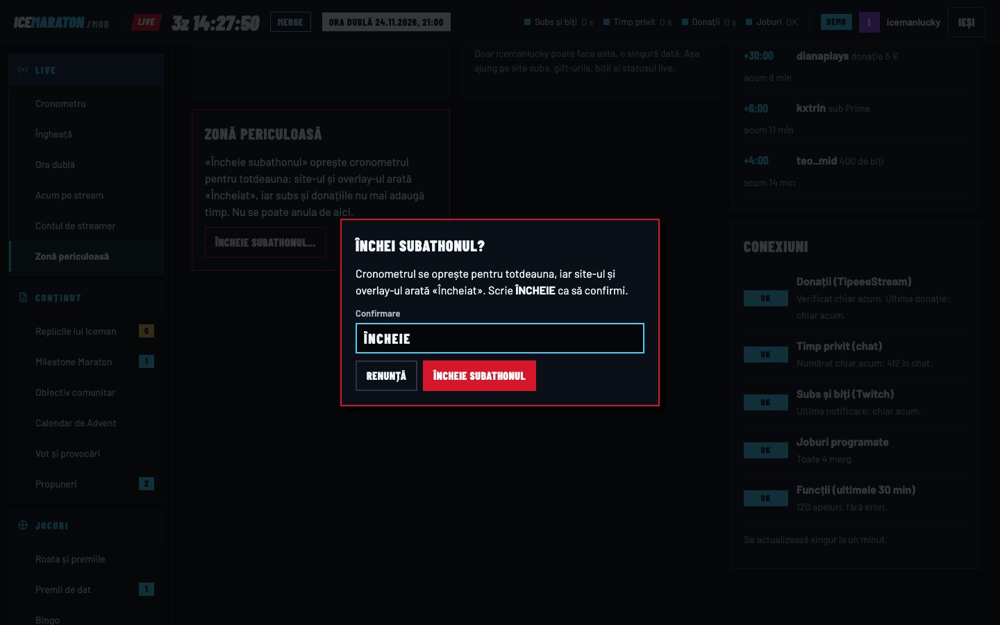 |

### /sponsori
- **S4:** the address keeps `?brand=` while you type, so the link can be sent already personalised. Step 1 points at the brand field.
- **S5:** upright phones read the step first, with the live preview under it. «Înapoi / Mai departe» stay pinned to the bottom. Step and action buttons are 44 px.
- **S1, option A:** a «Hai să vorbim» step (brand, package, name, message) opens the visitor's email app. It appears once `site.contactEmail` is set; until then the deck stays at 9 steps, with no placeholder.

| Before (phone) | After (phone) |
| --- | --- |
| 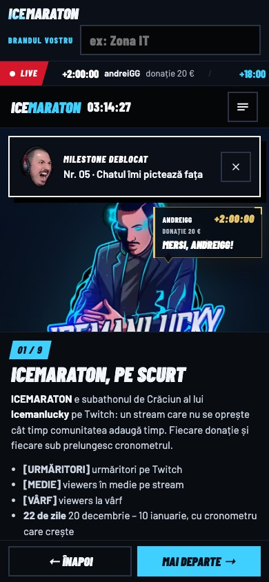 | 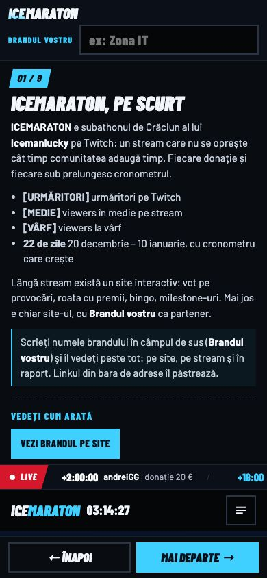 |

### Checks after the last commit
- **Widths:** 390, 768, 1280, 1440, 1920, 2560 and 3840 px on every page. No horizontal overflow, the navbar stays on one row everywhere, and there are no console errors apart from the expected 404 test page.
- **Lighthouse 12.6.1** (Phase 1 used 13.6.0):
  - `/` desktop: 100 / 100 / 100 / 100 (performance, accessibility, best practices, SEO).
  - `/` mobile: 97 / 100 / 100 / 100. Phase 1 had 98 for performance.
  - Accessibility: `/?demo` 100, `/mod/?demo` 100, `/sponsori/` 100.
- **Reduced motion:** every new transition is off. On phones, the jump to the preview in the sponsor deck is instant.

### Waiting on you
- **Donation URL (TipeeeStream):** the «Donează» buttons appear as soon as it's in `site.links.donate`.
- **Contact email:** step 10 of the deck and the «Scrie-ne» links appear as soon as it's in `site.contactEmail`.
- **S2 and S3:** audience numbers with a source, and package details and prices (`src/data/pitch.ts`).
- **Needs your OK:**
  - ~~the migration `20261126100000_bug_fixes.sql`~~ applied on 23 Nov 2026;
  - M1 (sponsors on /mod) and S1 option B (an inbox on /mod), which both need migrations;
  - deploying (`npm run deploy`) and pushing.

