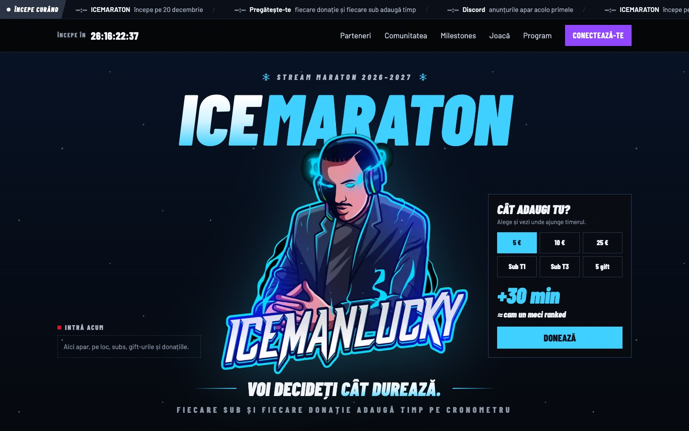
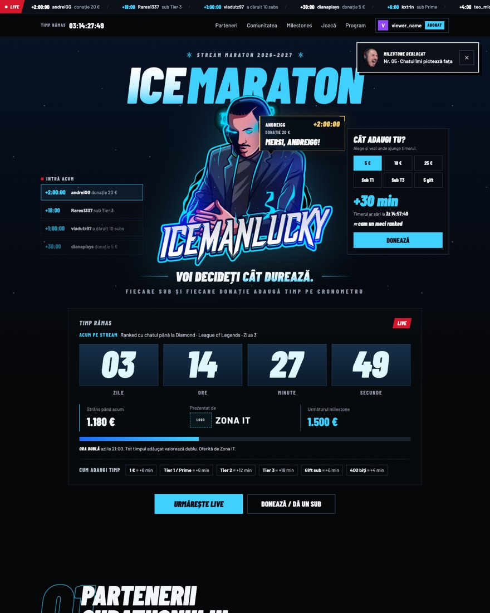
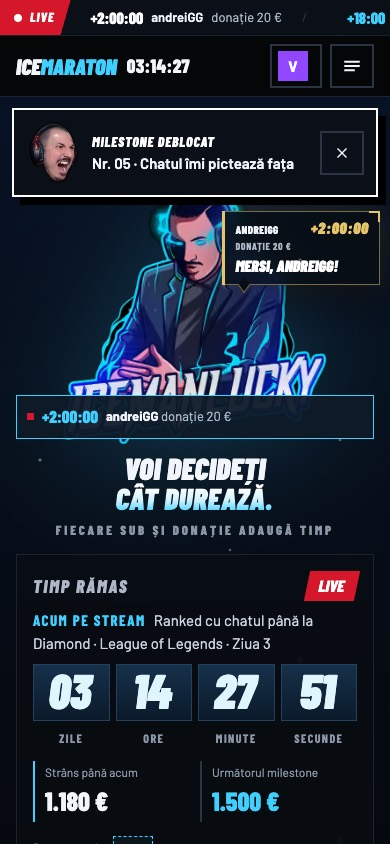
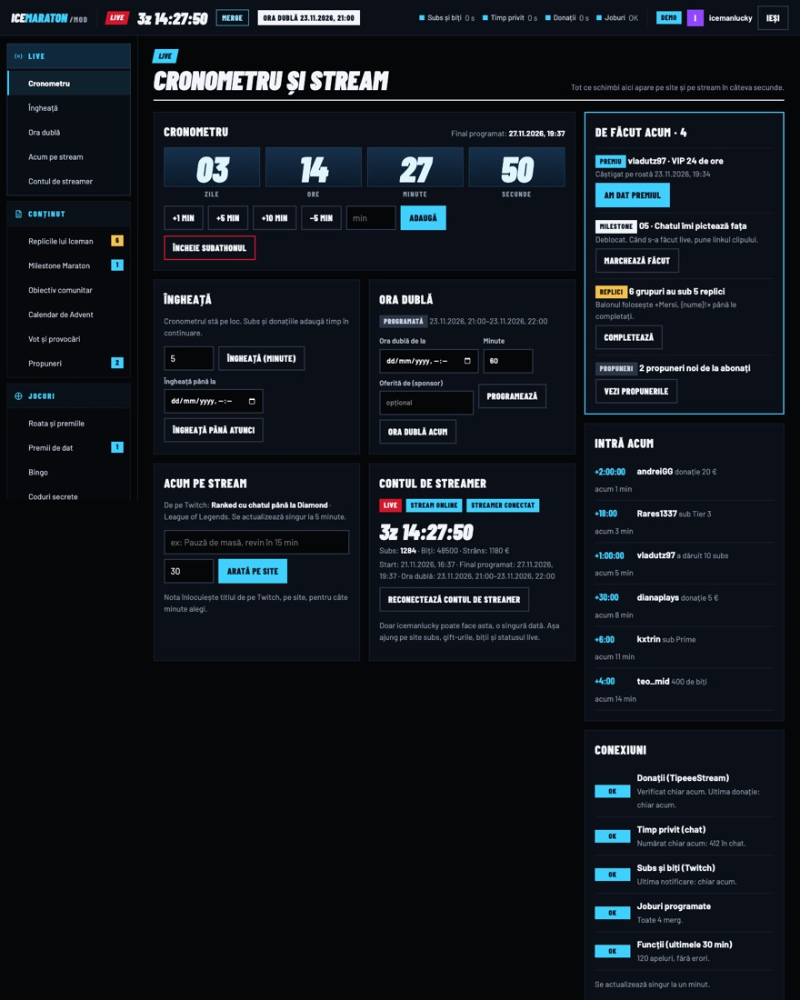
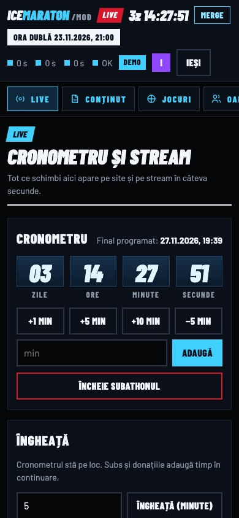
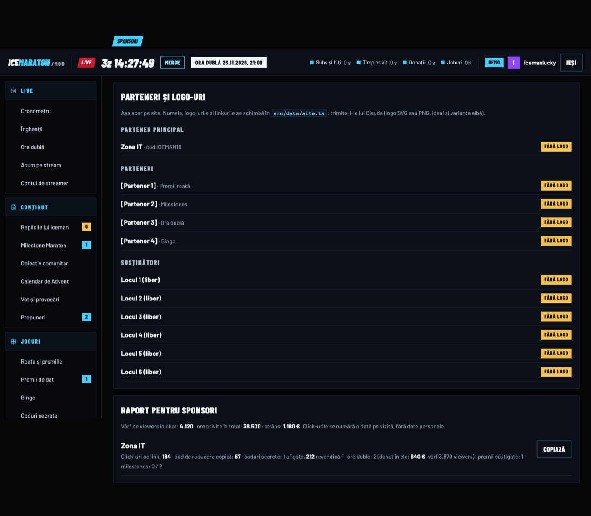
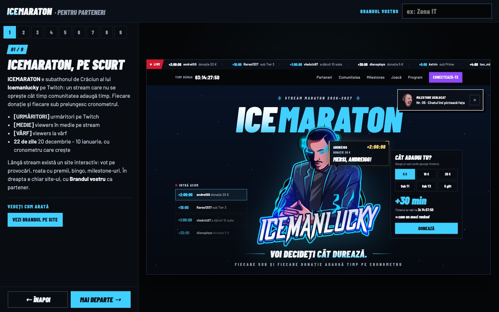
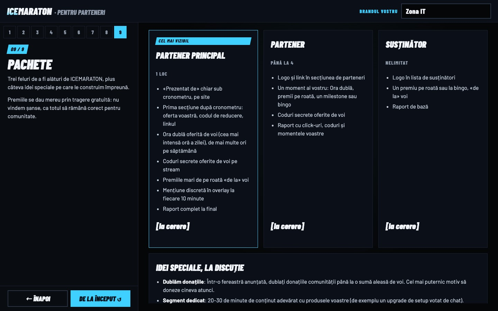
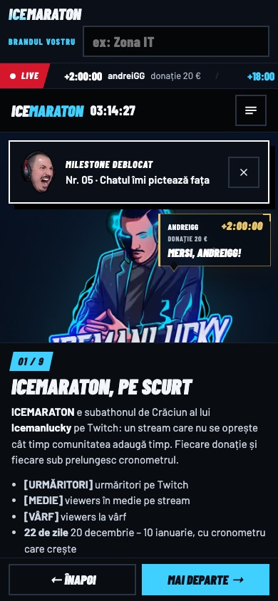
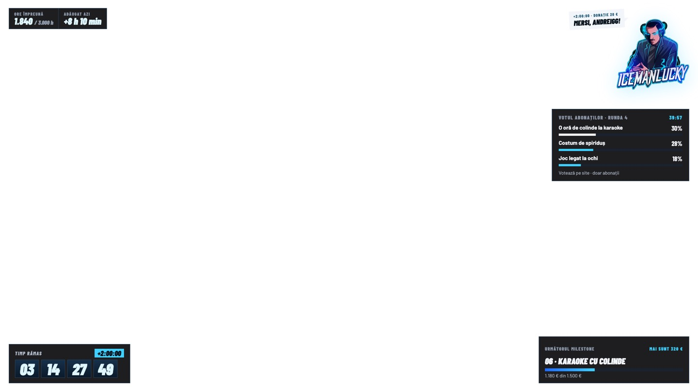

# UX audit (Phase 2, 23 Nov 2026)

What a viewer, a moderator and a sponsor actually meet on each surface, and the five changes per surface that would help most. It builds on [FLOWS.md](FLOWS.md) (every flow per role) and [BUGS.md](BUGS.md) (the test pass); bug numbers below point there.

**Method.** Local production build (`astro preview`), driven with Playwright in Chrome:
- **Viewer page:** `/` with live data, still before the start, and `/?demo` in the three viewer states.
- **Moderator console:** `/mod/?demo`.
- **Sponsor deck:** `/sponsori/`, all 9 steps.
- **Overlay:** `/overlay/?demo` at 1920 × 1080.

Measured at 1280 × 720, 1366 × 768, 1440 × 900 and 1920 × 1080, plus phones at 390 × 844 and 375 × 667. Every screenshot is in [`docs/ux/`](ux/).

**Ground rules taken as fixed** (CLAUDE.md and owner decisions):
- The ice look, a navbar on one row, and calm sponsors.
- The main sponsor sits under the timer, and the partner section is the first section after the hero. Both are promised to sponsors in `/sponsori` step 2.
- No gambling mechanics and no fake urgency.

---

## 1. Viewer: icemanlucky.ro

| First screen, 1440 × 900 (live data, before the start) | Hero down to the timer, 1440 (`/?demo`, subscriber) | First screen, 390 × 844 |
| --- | --- | --- |
|  |  |  |

**What works.**
- The identity is strong and consistent.
- «Voi decideți cât durează» says the whole idea in four words.
- The «Cum adaugi timp» rates sit right on the timer card.
- The «Contribuția ta» card shows each viewer what they personally added.
- The navbar is on one row at every width, and the navbar timer is always there.
- Lighthouse scores 98–100.

### Top 5

**V1. The countdown isn't on the first screen of any desktop.**
- The page is about the timer, but its digits end at **1,085–1,117 px** from the top on every desktop size measured. That is below the fold even on 1920 × 1080.
- The first screen is the logo art, the «Intră acum» feed and the calculator. On desktop the only timer you see is the small one in the navbar.
- The sponsor's «Prezentat de Zona IT» line is also below the fold. That's the spot sold as the place «la care se uită toată lumea».
- On phones it fits at 390 × 844 (digits end at 712 px), but not at 375 × 667 (699 px).
- *Change:* on desktop, put the timer card next to the mascot, or right under a shorter mascot, so the digits, «Strâns» and «Prezentat de» are all visible at 1280 × 720. The mascot stays; it gets about 40% less height. This is the main mockup in [DESIGN.md](DESIGN.md).

**V2. Both donate buttons lead nowhere.**
- «Donează» on the calculator and «Donează / dă un sub» under the timer both link to `#` (`site.links.donate`).
- This is the main money path, and it is placeholder B-25 promoted to the top.
- One button also mixes two actions: a donation on TipeeeStream and a sub on Twitch. The sub link already exists in `site.links.subscribe`.
- *Change:* point «Donează» at the TipeeeStream donation page for the `icemanlucky` account (the owner must confirm the exact URL), and split the second button into «Donează» and «Dă un sub».

**V3. Before the start, the calculator promises time that won't be added.**
- «Cât adaugi tu?» shows «+30 min · ≈ cam un meci ranked» while the marathon is «ÎNCEPE CURÂND». It rightly hides «Timerul ar sări la …», but the «+30 min» still reads as time you add.
- But `record_event` adds **0 seconds** unless the timer is `live`, so a donation made today counts toward «Strâns» and the milestones but not toward the clock. Logged as **B-31** in BUGS.md.
- *Change, which needs an owner decision:*
  - (a) Before the start, show what the money does do: «Până pe 20 decembrie, donațiile se adună la Strâns și deblochează milestone-uri; timpul se adaugă de la start».
  - (b) Or bank the time: donations before the start add to the opening duration. This needs a database change.

**V4. The first thing after the timer is ten empty boxes.**
- Section 01 shows the main sponsor, then four «[Partener 1–4]» tiles with «LOGO» boxes, then six empty supporter boxes and «Scrie-ne la [EMAIL CONTACT]».
- It is the most visible section after the timer, and today it reads as unfinished.
- *Change:* show only the partners that exist. Replace the empty tiers with a single line, «Locuri libere pentru parteneri · Scrie-ne», that links to `/sponsori`. The layout stays as designed; it fills in as sponsors sign.

**V5. The things viewers can do are ~5,000 px down, and the page doesn't say what's open to *me*.**
- The page is 8,900 px long on desktop and 10,100 px on phones.
- The wheel, the vote and bingo («04 · Joacă») start about halfway down.
- A logged-out visitor meets four different login prompts: «Conectează-te ca să învârți», «Conectează-te cu Twitch ca să-ți verificăm abonamentul», «Conectează-te și abonează-te ca să propui provocări», and bingo.
- A subscriber isn't told up front that a spin is ready or that a vote round is open.
- *Change:* add a slim, state-aware «Ce poți face acum» row directly under the timer card, with two to four jump links:
  - «Roata · ai 1 rotire»
  - «Votul · runda 4, 39 min»
  - «Bingo · alege linia până pe 25 dec»
  - For logged-out visitors, a single «Conectează-te cu Twitch» with one line on what it unlocks.

  This shortens no section and moves none (sponsors stay first). It gives each visitor their next step.

**Other findings (smaller).**
- On phones, the «Milestone deblocat» toast covers the top of the hero when the page loads. Toasts that arrive in the first 2–3 s could wait.
- The live player is section 05, near the bottom; «Urmărește live» goes to Twitch. That's fine (watch time counts in Twitch chat), but the on-page player could be mentioned next to the button.
- The page doesn't say when the data stops updating after load (B-11).

---

## 2. Moderator console: /mod

| LIVE group, 1440 (`/mod/?demo`) | LIVE group, 390 | Sponsors group, 1440 |
| --- | --- | --- |
|  |  |  |

**What works.**
- Grouped navigation with counts (LIVE · Conținut · Jocuri · Oameni · Sponsori · Overlay).
- «De făcut acum» lists what needs a human: prizes to give, milestones to mark, replies to fill in, suggestions.
- The status bar keeps the timer, «MERGE» and Ora dublă always visible.
- «Conexiuni» checks every integration.
- Since the Phase 1 fixes, one click is one request and live refreshes keep what you typed.

### Top 5

**M1. Sponsors, logos, links, codes and the donate link can't be changed from /mod.**
- The Sponsors group says so itself: «se schimbă în `src/data/site.ts`: trimite-i-le lui Claude».
- During a 22-day event where sponsors sign late, and a code or offer URL can change overnight, every change needs a developer and a deploy.
- *Change:* add a `sponsors` table: tier, name, logo URL, link, code, what they back, order and visible. Add a form in Sponsori → «Parteneri și logo-uri», and have the page read it through `public_state`. The donate link and socials can go in the same settings row.
- Needs a migration (your OK). Logos stay files in `public/sponsors/`, or in Supabase Storage if you prefer uploads from /mod.

**M2. «Încheie subathonul» sits right under the time buttons, behind a browser `confirm()`.**
- On desktop it is the next row after «+1 MIN · +5 MIN · +10 MIN · −5 MIN»; on a phone it's one thumb-length away.
- Ending the marathon can't be undone from /mod.
- *Change:* move it to a separate «Zonă periculoasă» block at the bottom of the LIVE group, with a dialog in the site's style that asks you to type «ÎNCHEIE».
- Use the same pattern for «Ora dublă acum» and removing a moderator (B-30), but keep a plain confirm for those.

**M3. Edits can be lost without warning.**
- The Conținut group is one long page (≈ 4,200 px) with nine separate «Salvează …» buttons: replies, milestones, community goal, Advent, and so on.
- Typed values now survive live refreshes (B-04), but leaving the page, reloading or closing the tab drops unsaved edits silently. Nothing marks which card has changes.
- *Change:*
  - Show a «nesalvat» tag on the card's title as soon as a field changes.
  - Warn before leaving the page (`beforeunload`) while any card has unsaved changes.
  - Keep each card's save button visible at the bottom of the screen while you edit a long card.

**M4. On a phone, system status is dots without words.**
- Below 768 px the bar shows «■ 0 s ■ 0 s ■ 0 s ■ OK». The labels (Subs și biți, Timp privit, Donații, Joburi) are hidden, so the state is colour and position only.
- A moderator on a phone during the stream is the common case.
- *Change:* on phones, show one summary chip, «Totul merge» or «1 problemă · Donații», that opens «Conexiuni». Keep the four labelled dots on desktop.

**M5. Keyboard and recovery.**
- There is no skip link. It takes 32 Tab presses from the top to reach «+1 MIN».
- After a laptop sleeps, the console doesn't reconnect by itself (B-14).
- *Change:*
  - Add «Sari la cronometru» and «Sari la De făcut acum» skip links.
  - Make the sidebar one Tab stop that you move through with the arrow keys.
  - Reconnect and refresh when the tab becomes visible again.

**Other findings (smaller).**
- The milestone editor (12 rows × 8 columns of inputs) cuts long titles at 1440 px, e.g. «Pulover urât de Crăciun…». A wider title column, or one row per milestone with details below, would help.
- The date fields use the browser's `dd/mm/yyyy, --:--` picker. That's fine, but the time zone isn't stated. «Ora României» next to them would remove doubt for moderators abroad.

---

## 3. Sponsors: /sponsori (and the sponsor slots on the site)

| Step 1, 1440 | Step 9 «Pachete», 1440 | Step 1, 390 |
| --- | --- | --- |
|  |  |  |

Overlay at 1920 × 1080 (transparent background shown as white), for reference: 

**What works.**
- A guided 9-step deck with the real site live on the right: «Vezi brandul pe site», «Pornește ora dublă», «Arată un cod pe stream».
- Typing a brand name puts it on every slot.
- It is calm and honest, and says plainly that prizes are drawn for free («nu vindem șanse»).
- Step 8 shows the per-sponsor report.

### Top 5

**S1. A convinced sponsor has nowhere to go.**
- Step 9 «Pachete» ends with «De la început ↺». The deck has no contact button.
- The site's only contact is «Scrie-ne la [EMAIL CONTACT]».
- *Change:* add a closing step, «Hai să vorbim», with the brand name already typed, a package choice, a contact name and email, and a short message. Two ways to send it are in *Sponsor checkout* below. No payment.

**S2. Audience numbers are placeholders on the first step.**
- Step 1 reads «[URMĂRITORI] urmăritori», «[MEDIE] viewers în medie», «[VÂRF] viewers la vârf». That is the first thing a sponsor judges.
- CLAUDE.md has the last subathon at about 46,800 unique viewers and around 500 concurrent. Those numbers need your confirmation and a source (Twitch analytics or a tracker). I won't fill them in myself.
- *Change:* fill them in from you, and add a one-line source and date under them.

**S3. Packages don't say what you get in numbers, or what it costs.**
- Every tier is «[la cerere]».
- The bullets say «de mai multe ori pe săptămână» and «Un moment al vostru» but not how many: Ora dublă slots, overlay mentions per day, secret codes, wheel prizes.
- *Change:*
  - Show a comparison table with quantities per tier over the 22 days.
  - Show «de la … €» or «la cerere» per tier.
  - Mark one tier as taken when the main partner is signed («Partener principal · ocupat»). That is honest scarcity, not fake urgency.

**S4. The personalised preview is easy to miss and can't be shared.**
- «Brandul vostru» is a small field at the top right. On phones it sits above the deck, where nothing explains it.
- Iceman can't send a sponsor a link with their name already filled in.
- *Change:*
  - Read `?brand=Zona%20IT` from the address, so the deck opens personalised.
  - Optionally preview a logo, chosen locally and never uploaded.
  - Add one line at step 1: «Scrieți numele brandului sus și îl vedeți pe site».

**S5. On phones the deck is cramped.**
- At 390 px the live preview takes the top half of the screen, and the step text starts below it and runs under the fixed «Înapoi / Mai departe» bar.
- The step buttons are 36 × 36 px (B-24).
- *Change:* on phones, put the text first with the preview below it, and give the step buttons 44 px.

**On the site itself.** V1 and V4 above are sponsor issues too. «Prezentat de» is below the fold on desktop, and empty partner boxes make the sponsors look like placeholders.

### Sponsor checkout (decision for you)

There is no sponsor purchase flow, and I haven't built one or touched any payment keys. A self-serve checkout (card payment for a package) doesn't fit well here:
- Packages are custom: dates, prizes and what each sponsor backs.
- Most sponsors will want an invoice.
- A payment provider adds legal and tax work (company details, VAT, refunds).

My proposal is an **inquiry flow, not a checkout**. It is step S1 plus the overlay preview the deck already has (step 7). Two ways to build it:

| | How it sends | Needs |
| --- | --- | --- |
| **A. Email** | The form opens the visitor's email client with the brand, package and message filled in. | Only your contact email. No backend, no database. |
| **B. Inbox on /mod** | The form saves to a `sponsor_inquiries` table (insert only, rate-limited, no reading from the browser). Moderators see it in Sponsori → «Cereri» and get a «De făcut acum» item. | A migration (your OK), plus a privacy line on the form. It stores a name and email. |

Payment stays offline (invoice or bank transfer), as now. If you later want online payment for a fixed package, it's a separate decision: provider, company details and VAT.

---

## Summary: the 15 changes

| # | Surface | Change | Needs |
| --- | --- | --- | --- |
| V1 | Viewer | Timer, «Strâns» and «Prezentat de» on the first screen of every desktop | Design OK |
| V2 | Viewer | Working «Donează» (TipeeeStream) and a separate «Dă un sub» | Donation URL |
| V3 | Viewer | Calculator tells the truth before the start (B-31) | Your decision: (a) or (b) |
| V4 | Viewer | Hide empty partner boxes; one «Locuri libere» line | None |
| V5 | Viewer | «Ce poți face acum» row under the timer | Design OK |
| M1 | /mod | Edit sponsors, links and codes on /mod | Migration OK |
| M2 | /mod | «Încheie subathonul» in a danger zone, confirmed by typing | None |
| M3 | /mod | «Nesalvat» tags and a warning before leaving | None |
| M4 | /mod | Status summary chip on phones | None |
| M5 | /mod | Skip links, arrow-key sidebar, reconnect after sleep | None |
| S1 | Sponsors | «Hai să vorbim» step (inquiry, not checkout) | Contact email, A or B |
| S2 | Sponsors | Real audience numbers with a source | Your numbers |
| S3 | Sponsors | Quantities per tier; «ocupat» when taken | Your package details |
| S4 | Sponsors | `?brand=` links and a clearer brand field | None |
| S5 | Sponsors | Phone layout: text first, 44 px steps | None |
